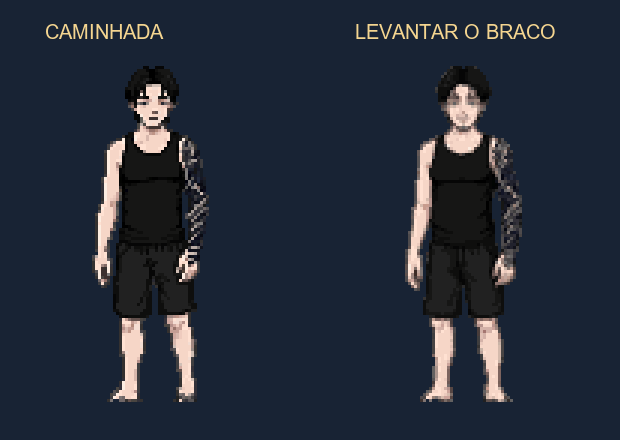

# Boss Dev — caminhada e levantar do braço pelo MCP

Pedido do usuário em 2026-10-15. Arte criada com `mcp__pixellabs__animate_image`, usando as poses atuais do jogo como referência.

- Caminhada frontal: oito poses novas, loop de 12 FPS. O editor gratuito do MCP alinhou os quadros para compensar o deslocamento horizontal produzido pelo gerador, sem alterar os pixels do personagem.
- Conjuração: oito poses novas mais o repouso original; reprodução de 19 quadros a 24 FPS com pausa no lançamento e retorno usando as mesmas poses em ordem inversa. Ligada ao evento `boss_cast` nas direções frontais disponíveis. A pose de costas existente permanece como fallback.
- Altura de desenho e barra de vida estáveis em 160 px. A caminhada está disponível ao renderizador quando há movimento; as regras atuais do Boss continuam usando teleporte.

Originais em `caminhada/` e `conjuracao/`. [Pedido e prompts](PEDIDO.json), [recibos, sequência e hashes](ENTREGA.json). Foram consumidas duas gerações; saldo após: zero gerações do trial, bônus diário exibido de oito e US$0,00. O PixelLab depois recusou uma geração Pro para o Snoop por trial encerrado; o bônus exibido não garantiu acesso a novas gerações por IA.

Validação no Godot 4.7.2: [movimentos 13/0](teste_movimento.log), [batalha completa do Boss em OpenGL 77/0](teste_boss.log). Não reexportado para Web nesta etapa.
