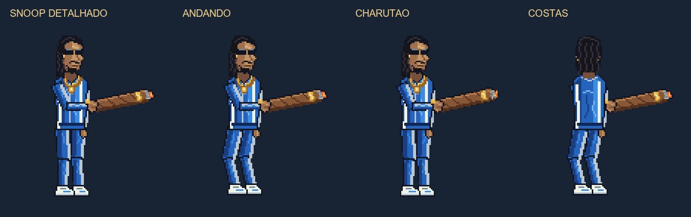

# Snoop e charutão — detalhe antes dos movimentos

Pedido direto do usuário em 2026-10-15, após a animação do Boss. Criado e animado pelo MCP PixelLab `pixelart_workbench`, editor gratuito de pixels e camadas.

A tentativa de geração Pro foi recusada pelo trial encerrado, sem gerar imagem. O trabalho continuou no editor gratuito: desenho autorado com tranças, óculos, cavanhaque, corrente/bracelete dourados, agasalho azul com faixas brancas, zíper, dobras e tênis. O charutão tem textura de folha enrolada, faixa dourada, cinza e brasa. A base detalhada foi renderizada e revisada antes de criar os movimentos.

- Quatro vistas: frente e costas em três quartos, com as respectivas vistas espelhadas pelo MCP. As oito direções do jogo usam essas quatro vistas, conforme o mapeamento explícito do manifesto.
- Caminhada: 16 quadros por vista, 16,67 FPS; pernas, joelhos, braços e charutão articulados.
- Fumar: 16 quadros por vista, 11,11 FPS; mão leva o charuto à boca, brasa acende, baforadas verdes sobem e o braço retorna.
- 132 PNGs de jogo: quatro bases, 64 quadros de caminhada e 64 de fumar. Canvas 112×128; pixels dos PNGs exportados pelo MCP preservados no empacotamento.

## Integração e evidências

O manifesto de aparência aponta para a nova base. O combate usa a caminhada ao deslocar e o gesto de fumar em repouso; stun/morte interrompem os movimentos. O charutão faz parte dos quadros e acompanha a mão, sem duplicar o acessório antigo. O compêndio mostra os movimentos e a taxa real. A escala de tela mantém os 68 px de referência e o crescimento por nível.

[Receitas da base](base_RECEITA.json), [caminhada](walk_RECEITA.json), [fumar](smoke_RECEITA.json), [proveniência e hashes](ENTREGA.json). Custo de gerações do Snoop: zero. Originais anteriores preservados em suas pastas.

Godot 4.7.2: [integração específica 39 aprovadas, zero falhas, OpenGL](teste_integracao.log). [Captura real do compêndio](compendio.png) conferida. A miniatura da fumaça na carta de habilidade passou a caber no quadro e a respeitar seu recorte; [captura anterior](compendio_antes_limite_vfx.png).

O smoke inicial apontou cinco expectativas incompatíveis: manifesto do Snoop ainda antigo (corrigido na integração), arena de 351 px já substituída pela HD, Barbie/Ken ainda esperados em 68 px em vez de 72/74 e revelação fixa de dez unidades apesar dos bots variados. As verificações foram atualizadas para a aparência ativa e para comparar a revelação com os ativos autoritativos da simulação, preservando a checagem de presença e escala. [Primeiro resultado](smoke.log), [após manifesto](smoke_apos_manifesto.log), [validação final](smoke_final.log).

Entrega local; não reexportada nem publicada na Web nesta etapa.
