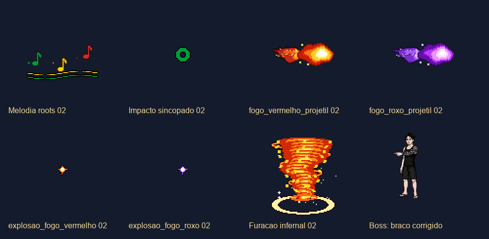

# Bob Marley e Boss Dev — integração dos refinamentos

Concluído em 2026-10-15, por pedido do usuário para integrar, fazer commit e push.

- Bob: melodia reggae em loop e impacto musical com 16 quadros; usados no combate e na ficha do compêndio.
- Boss: projéteis vermelho/roxo, duas explosões e furacão, todos com 16 quadros. Trajetória, eventos, dano e regras existentes preservados.
- Braço: conjuração para a esquerda seleciona `assets/characters/boss_dev/refino_02/cast_south_west.png`, com âncora nos pés e escala normalizada para manter 160 px. A referência escolhida mostra o braço tatuado apontando à esquerda. Os PNGs anteriores continuam preservados.

Arte produzida pelo MCP PixelLab (`vfx_workbench` e edição de pixels); [receitas finais e recibos](ORIGEM.json), [origem e operações do braço](BRACO_PIXEL_LAB.json) e [integridade dos downloads](INTEGRIDADE.json). As receitas finais são as de `ORIGEM.json`; `receitas.json` registra o estágio inicial. Esta integração não fez novas gerações pagas.

## Validação

Godot `4.7.2.stable.official.ed1daf0bf`. Cópia isolada de `0949122` mais somente as alterações desta entrega, sem incluir animações/poses em edição paralela no workspace:

| Verificação | Resultado | Evidência |
| --- | --- | --- |
| Biblioteca de VFX | 332 aprovadas / 0 falhas | [log](vfx_snapshot.log) |
| Smoke do cliente | 488 / 0 | [log](smoke_snapshot.log) |
| Integração Bob/Boss, OpenGL | 19 / 0 | [log](integracao_snapshot.log) |
| Batalha completa do Boss, OpenGL | 77 / 0 | [log](boss_snapshot.log) |

Total: 916 verificações. As regressões verificam os 16 recortes, cadência, término/loop, trajetória, direção, seleção da pose e altura estável. Capturas reais conferidas visualmente: [Bob no compêndio](bob_compendio.png), [Boss em combate](boss_combate.png). Não constitui validação de balanceamento, multiplayer ou celular.

O push envia o código e os assets versionados; esta entrega não reexportou nem publicou uma nova build Web.
